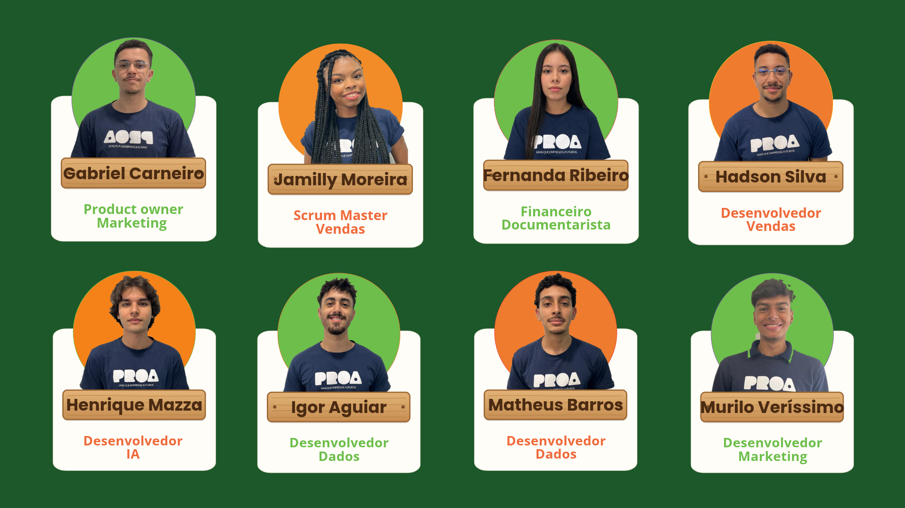

  <picture>
    <source media="(prefers-color-scheme: dark)" srcset="assets/logo-texto-branca.png">
    
  </picture>

# Integrantes

 

# 1. Equipe e divisão de responsabilidades

A equipe do Xepa+ é composta por oito integrantes, com funções relacionadas à organização do projeto, documentação, finanças, marketing, vendas, desenvolvimento, inteligência artificial e dados. Além das responsabilidades específicas, todos os integrantes participaram do desenvolvimento front-end utilizando React e Figma e da elaboração do pitch.

| Integrante | Cargo primário | Cargo secundário |
| :--- | :--- | :--- |
| **Fernanda Ribeiro** | Documentarista | Financeiro |
| **Gabriel Carneiro** | Product Owner | Marketing |
| **Hadson de Jesus** | Desenvolvedor | Vendas |
| **Henrique Mazza** | Desenvolvedor | IA |
| **Igor Aguiar** | Desenvolvedor | Dados |
| **Jamilly Moreira** | Scrum Master | Vendas |
| **Matheus Barros** | Desenvolvedor | Dados |
| **Murilo Verissimo** | Desenvolvedor | Marketing |

  

Figura 1 – Equipe do Xepa+

 

# 2. Informações dos integrantes

## Fernanda Ribeiro

| Campo | Informação |
| :--- | :--- |
| **Nome completo** | Fernanda Ribeiro Pinto |
| **Cargo primário** | Documentarista |
| **Cargo secundário** | Financeiro |
| **Responsabilidades** | Área financeira da plataforma e desenvolvimento full stack. É responsável, junto com o Igor, pela hospedagem, pelas rotas, pelo domínio e pela integração entre o back-end e o front-end. |
| **E-mail** | [f3rnandarib3iro@gmail.com](mailto:f3rnandarib3iro@gmail.com) |
| **E-mail institucional** | [fernanda.rpinto@senacsp.edu.br](mailto:fernanda.rpinto@senacsp.edu.br) |
| **Telefone** | (11) 99221-5045 |
| **LinkedIn** | [https://www.linkedin.com/in/f3f3h/](https://www.linkedin.com/in/f3f3h/) |
| **GitHub** | [https://github.com/f3f3h](https://github.com/f3f3h) |

## Gabriel Carneiro

| Campo | Informação |
| :--- | :--- |
| **Nome completo** | Gabriel Carneiro Sandes |
| **Cargo primário** | Product Owner |
| **Cargo secundário** | Marketing |
| **Responsabilidades** | Contato com os feirantes, visitas às feiras e gravação de conteúdo. Também atua no pitch e no desenvolvimento full stack. |
| **E-mail** | [gabrielcarneiro780@gmail.com](mailto:gabrielcarneiro780@gmail.com) |
| **E-mail institucional** | [gabriel.csandes@senacsp.edu.br](mailto:gabriel.csandes@senacsp.edu.br) |
| **Telefone** | (11) 95972-0652 |
| **LinkedIn** | [https://www.linkedin.com/in/gabriel-carneiro-5459b6303/](https://www.linkedin.com/in/gabriel-carneiro-5459b6303/) |
| **GitHub** | [https://github.com/carneirogabri](https://github.com/carneirogabri) |

## Hadson de Jesus

| Campo | Informação |
| :--- | :--- |
| **Nome completo** | Hadson Ferreira de Jesus |
| **Cargo primário** | Desenvolvedor |
| **Cargo secundário** | Vendas |
| **Responsabilidades** | API de mapa das feiras e desenvolvimento full stack. |
| **E-mail** | [fhadson@gmail.com](mailto:fhadson@gmail.com) |
| **E-mail institucional** | [hadson.fjesus@senacsp.edu.br](mailto:hadson.fjesus@senacsp.edu.br) |
| **Telefone** | (11) 95630-8263 |
| **LinkedIn** | [https://www.linkedin.com/in/hadson-ferreira-068088271/](https://www.linkedin.com/in/hadson-ferreira-068088271/) |
| **GitHub** | [https://github.com/fhadson](https://github.com/fhadson) |

## Henrique Mazza

| Campo | Informação |
| :--- | :--- |
| **Nome completo** | Henrique Rodrigues Mazza do Valle |
| **Cargo primário** | Desenvolvedor |
| **Cargo secundário** | IA |
| **Responsabilidades** | Desenvolvimento da Xepinha, a assistente com inteligência artificial, e elaboração do banco de dados MySQL. |
| **E-mail** | [henriquerodriguesmazza@gmail.com](mailto:henriquerodriguesmazza@gmail.com) |
| **E-mail institucional** | [henrique.rmvalle@senacsp.edu.br](mailto:henrique.rmvalle@senacsp.edu.br) |
| **Telefone** | (11) 91350-3388 |
| **LinkedIn** | [https://www.linkedin.com/in/henriquemazzavalle/](https://www.linkedin.com/in/henriquemazzavalle/) |

## Igor Aguiar

| Campo | Informação |
| :--- | :--- |
| **Nome completo** | Igor Aguiar Rodrigues |
| **Cargo primário** | Desenvolvedor |
| **Cargo secundário** | Dados |
| **Responsabilidades** | Página de receitas e desenvolvimento full stack. É responsável, junto com a Fernanda, pela hospedagem, pelas rotas, pelo domínio e pela integração entre o back-end e o front-end. |
| **E-mail** | [igoraguiar0101@gmail.com](mailto:igoraguiar0101@gmail.com) |
| **E-mail institucional** | [igor.arodrigues3@senacsp.edu.br](mailto:igor.arodrigues3@senacsp.edu.br) |
| **Telefone** | (11) 94642-0627 |
| **LinkedIn** | [https://www.linkedin.com/in/igor-aguiar-ab193132b/](https://www.linkedin.com/in/igor-aguiar-ab193132b/) |
| **GitHub** | [https://github.com/Igordevice](https://github.com/Igordevice) |

## Jamilly Moreira

| Campo | Informação |
| :--- | :--- |
| **Nome completo** | Jamilly Moreira de Jesus |
| **Cargo primário** | Scrum Master |
| **Cargo secundário** | Vendas |
| **Responsabilidades** | Organização do projeto, controle de prazos e distribuição das responsabilidades. Também apresenta o pitch. |
| **E-mail** | [jamillymoreira963@gmail.com](mailto:jamillymoreira963@gmail.com) |
| **E-mail institucional** | [jamilly.mjesus@senacsp.edu.br](mailto:jamilly.mjesus@senacsp.edu.br) |
| **Telefone** | (11) 91351-3383 |
| **LinkedIn** | [https://www.linkedin.com/in/jamillymoreira/](https://www.linkedin.com/in/jamillymoreira/) |
| **GitHub** | [https://github.com/milly-m-dev](https://github.com/milly-m-dev) |

## Matheus Barros

| Campo | Informação |
| :--- | :--- |
| **Nome completo** | Matheus de Souza Barros |
| **Cargo primário** | Desenvolvedor |
| **Cargo secundário** | Dados |
| **Responsabilidades** | Dados e desenvolvimento full stack. |
| **E-mail** | [sjmatheus07@gmail.com](mailto:sjmatheus07@gmail.com) |
| **E-mail institucional** | [matheus.sbarros14@senacsp.edu.br](mailto:matheus.sbarros14@senacsp.edu.br) |
| **Telefone** | (11) 95069-7883 |
| **LinkedIn** | [https://www.linkedin.com/in/matheus-barros-13b652330/](https://www.linkedin.com/in/matheus-barros-13b652330/) |
| **GitHub** | [https://github.com/MatheusSouzaBarros](https://github.com/MatheusSouzaBarros) |

## Murilo Verissimo

| Campo | Informação |
| :--- | :--- |
| **Nome completo** | Murilo Verissimo Pereira |
| **Cargo primário** | Desenvolvedor |
| **Cargo secundário** | Marketing |
| **Responsabilidades** | Marketing e gestão do Instagram, além da elaboração do banco de dados MySQL. |
| **E-mail** | [muriloverissimo2008@gmail.com](mailto:muriloverissimo2008@gmail.com) |
| **E-mail institucional** | [murilo.vpereira1@senacsp.edu.br](mailto:murilo.vpereira1@senacsp.edu.br) |
| **Telefone** | (11) 98102-9405 |
| **LinkedIn** | [https://www.linkedin.com/in/murilo-verissimo-44a958372/](https://www.linkedin.com/in/murilo-verissimo-44a958372/) |
| **GitHub** | [https://github.com/verissimoMuh](https://github.com/verissimoMuh) |

 

---

<a href="README.md">← 1. Apresentação do projeto</a> · <a href="03-links-do-projeto.md">3. Links do projeto →</a>

