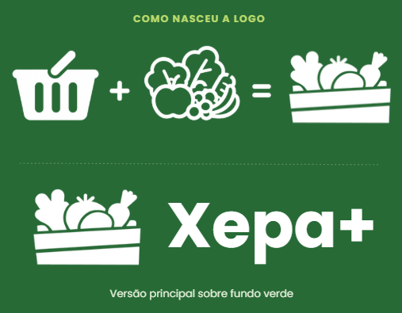
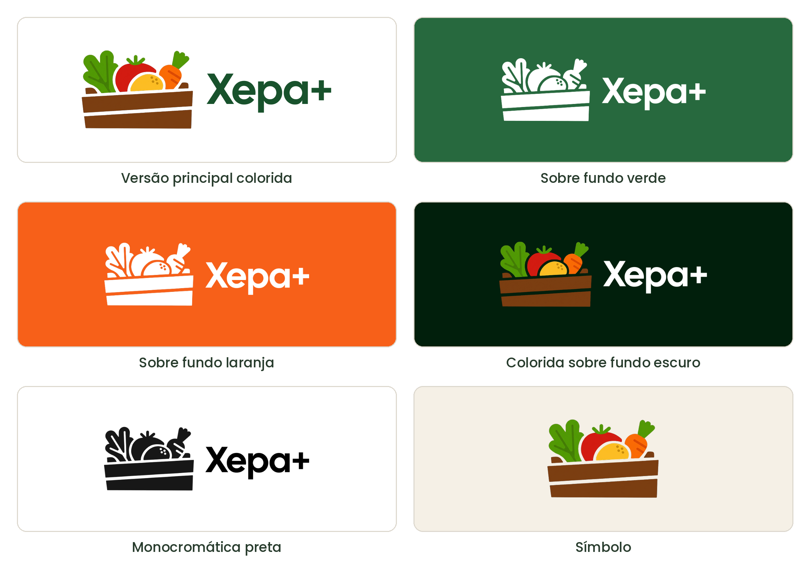
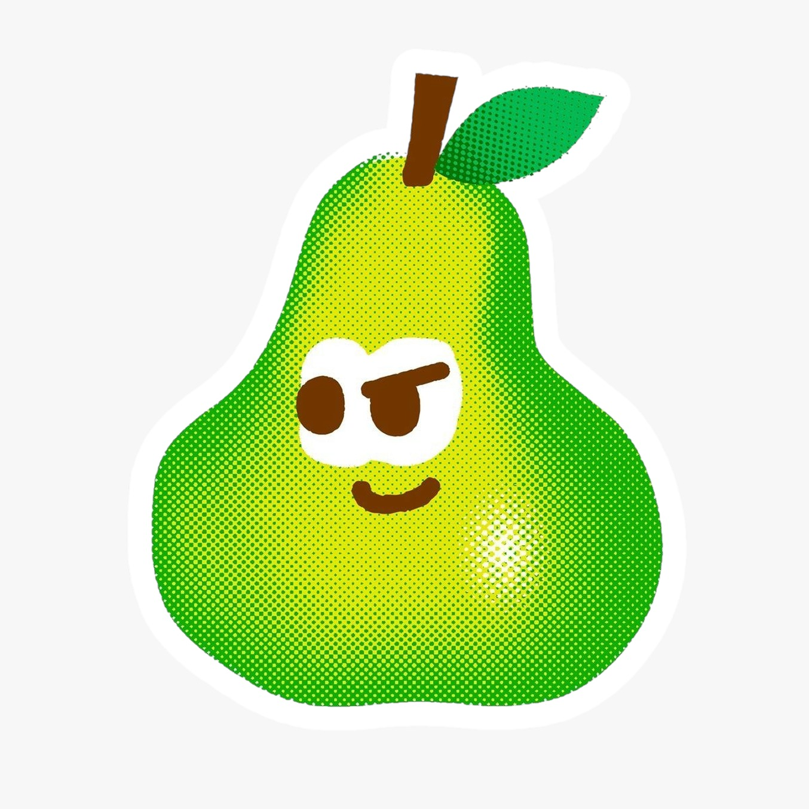
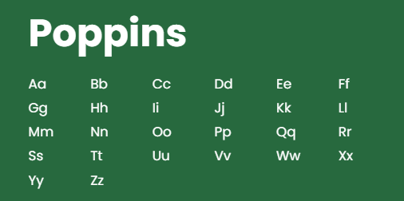

  <picture>
    <source media="(prefers-color-scheme: dark)" srcset="assets/logo-texto-branca.png">
    
  </picture>

# Identidade visual

 

# 1. Logo

A identidade visual do Xepa+ é inspirada na feira e utiliza uma paleta que combina verde, laranja, verde-amarelado, amarelo, cinza-escuro e branco. Ela é aplicada às páginas e aos componentes da plataforma, aos materiais de divulgação e à apresentação, contribuindo para a padronização das telas e para a consistência da experiência de navegação.

A logo une a cesta de compras aos alimentos que seriam desperdiçados e transmite três ideias: reaproveitamento, economia e sustentabilidade. O símbolo reforça o propósito da plataforma de dar um novo destino aos alimentos da xepa.

  

Figura 1 – Como nasceu a logo

## 1.1 Variações da logo

A logo tem duas variações: a verde, usada sobre fundos claros, e a branca, usada sobre fundo verde.

  

Figura 2 – Variações da logo

| Variação | Onde usar |
| :--- | :--- |
| **Verde** | Fundos claros: site, documentos, redes sociais e materiais impressos. |
| **Branca** | Fundo verde ou escuro: apresentação, capas e peças da marca. |

 

# 2. Naming

O nome une a palavra “xepa”, que identifica os alimentos que permanecem nas feiras ao final do expediente, ao sinal “+”, que representa transformação e benefício.

Por que o nome funciona:

- É uma palavra que o feirante e o freguês já usam: “hora da xepa”.
- É curto, fácil de falar e de lembrar.
- O “+” mostra que a xepa vale mais: mais alimento, mais renda e mais economia.

## 2.1 Como escrever o nome

| Forma | Uso | Observação |
| :--- | :--- | :--- |
| **Xepa+** | Correto | X maiúsculo e “+” junto da palavra, sem espaço. |
| **o Xepa+** | Correto | Em texto corrido, o nome é tratado no masculino: “o Xepa+ conecta…”. |
| **Xepa +, XepaMais, xepa mais** | Evitar | “XepaMais” e “xepamais” ficam só em endereços: site, GitHub e redes. |

## 2.2 Família de nomes

| Nome | O que é |
| :--- | :--- |
| **Xep.AI (Xepinha)** | Assistente virtual da plataforma, representada por uma pera. |
| **Semente, Broto e Colheita** | Planos do feirante, que seguem o ciclo da planta: começar sem mensalidade, crescer e colher mais resultados. |
| **Hora da xepa** | Ofertas do fim da feira na área do consumidor. |

## 2.3 Mascote

A Xepinha é a assistente virtual do Xepa+, criada para tornar a experiência mais simples, prática e divertida. Representada por uma pera, segue o mesmo estilo de frutas da identidade visual.

  

Figura 3 – Xepinha, mascote da Xep.AI

 

# 3. Fontes

A fonte Poppins foi escolhida por seu estilo moderno, geométrico e de boa legibilidade. Junto com a paleta inspirada na feira, ela deixa a comunicação moderna, acolhedora e fácil de reconhecer, e é usada nos títulos e textos da plataforma e da apresentação.

| Uso | Fonte | Licença |
| :--- | :--- | :--- |
| **Títulos** | Poppins SemiBold e Bold | SIL Open Font License 1.1 |
| **Corpo de texto** | Poppins Regular e Medium | SIL Open Font License 1.1 |
| **Destaques do site** | Cal Sans | SIL Open Font License 1.1 |
| **Código** | JetBrains Mono | SIL Open Font License 1.1 |

  

Figura 4 – Tipografia Poppins

## 3.1 Licenças

As três fontes usam a SIL Open Font License 1.1, que permite o uso gratuito em projetos pessoais e comerciais, a incorporação em sites, aplicativos e PDFs e a modificação. Não é permitido vender a fonte sozinha.

Todas estão disponíveis no Google Fonts. Fontes de apoio quando a principal não carregar: Arial (texto) e Consolas (código).

 

# 4. Paleta de cores

A paleta é inspirada na feira: o verde das folhas, o laranja das frutas e do toldo, o amarelo e o verde-amarelado dos legumes, com cinza-escuro e branco para leitura.

| Nome | HEX | RGB | Uso principal |
| :--- | :--- | :--- | :--- |
| Verde | #27693E | 39, 105, 62 | Cor principal: cabeçalho, botões e títulos. |
| Laranja | #F76019 | 247, 96, 25 | Destaques, chamadas e botões de ação. |
| Verde-amarelado | #9CB806 | 156, 184, 6 | Detalhes, etiquetas e item ativo do menu. |
| Amarelo | #FFC927 | 255, 201, 39 | Apoio em ilustrações e destaques. |
| Cinza-escuro | #161414 | 22, 20, 20 | Textos. |
| Branco | #FFFFFF | 255, 255, 255 | Fundos e textos sobre cores escuras. |

## 4.1 Contraste e acessibilidade

| Combinação | Contraste | Uso (WCAG 2.1) |
| :--- | :--- | :--- |
| **Cinza-escuro sobre branco** | 18,4 : 1 | Qualquer texto. |
| **Branco sobre verde (e verde sobre branco)** | 6,6 : 1 | Qualquer texto (AA). |
| **Cinza-escuro sobre amarelo** | 11,9 : 1 | Qualquer texto. |
| **Cinza-escuro sobre verde-amarelado** | 8,1 : 1 | Qualquer texto. |
| **Cinza-escuro sobre laranja** | 5,8 : 1 | Qualquer texto (AA). |
| **Branco sobre laranja** | 3,2 : 1 | Só texto grande e em negrito. |
| **Branco sobre amarelo ou verde-amarelado** | até 2,3 : 1 | Não usar para texto. |

 

# 5. Guia de identidade visual

A identidade visual é aplicada às páginas e aos componentes da plataforma, aos materiais de divulgação, ao dossiê e à apresentação, garantindo telas padronizadas e uma experiência de navegação consistente.

## 5.1 Elementos gráficos

- Toldo listrado em verde e laranja, que lembra as barracas da feira, no topo da capa.
- Frutas na base da capa, sobre fundo claro.
- Títulos em verde, em caixa alta, com linha laranja abaixo.
- Tabelas com cabeçalho verde e linhas em verde-claro.

## 5.2 Aplicações

| Peça | Como aplicar |
| :--- | :--- |
| **Site** | Fundo branco, cabeçalho verde, botões laranja e logo verde. |
| **Redes sociais** | Instagram, Facebook e TikTok com fotos de alimentos, logo e paleta da marca. |
| **Panfletos e cartazes** | Logo, slogan e QR Code para o agregador de links. |
| **Dossiê e apresentação** | Capa com toldo e frutas, títulos verdes com linha laranja e tabelas com cabeçalho verde. |

## 5.3 Uso da logo

- Usar a logo verde em fundo claro e a branca em fundo verde.
- Não esticar, girar ou trocar as cores da logo.
- Não aplicar a logo sobre fotos sem contraste.

## 5.4 Acessibilidade

Parte do público tem pouca familiaridade com ferramentas digitais. Por isso, o site conta com o widget de acessibilidade UserWay, rótulos nos formulários, textos alternativos nas imagens, atributos ARIA, layout responsivo e vídeos que respeitam a preferência por menos movimento.

 

# 6. Slogan e tom de voz

Slogan: “Mais alimento, menos desperdício.”

## 6.1 Tom de voz

O Xepa+ fala como a feira: perto, animado e direto. Usa as expressões que o feirante grita na banca e que o freguês já conhece, sem perder a clareza sobre preço, retirada e pagamento.

| Característica | Como aparece |
| :--- | :--- |
| **Popular** | Palavras do dia a dia da feira: freguês, banca, xepa, fresquinho. |
| **Acolhedor** | Trata todo mundo com simpatia, como o feirante que conhece o cliente. |
| **Claro** | Frases curtas. Preço, horário e regras sempre explicados. |
| **Transparente** | Sem sacola surpresa: diz o que vem, a validade e a condição. |

## 6.2 Falas da feira

Expressões populares das feiras livres que entram na comunicação da marca:

| Fala da feira | Como o Xepa+ usa |
| :--- | :--- |
| **“Olha a xepa!”** | Aviso de oferta nova: “Olha a xepa! A banca do José acabou de soltar ofertas perto de você.” |
| **“Chegou a hora da xepa!”** | Título da vitrine de ofertas do fim da feira. |
| **“Pode chegar, freguesa!”** | Boas-vindas na página inicial e no primeiro acesso. |
| **“Tá barato, tá baratinho!”** | Chamada de posts com desconto em destaque. |
| **“Leva que é fresquinho!”** | Cartão de oferta com validade e condição do produto. |
| **“Prova que é doce!”** | Receitas sugeridas para usar o que foi comprado. |
| **“É três por dez!”** | Cestas e combos. |
| **“É a última, vai levar?”** | Aviso de estoque baixo. |
| **“Fim de feira, preço de xepa”** | Frase de panfletos e cartazes nas feiras. |
| **“Freguês de sempre”** | Mensagem de recompra e avaliação da banca. |

## 6.3 Aplicação no dia a dia

| Situação | Assim | Assim não |
| :--- | :--- | :--- |
| **Botão de compra** | Quero essa xepa | Adicionar item ao carrinho de compras |
| **Pedido pronto** | Tá separado! Retire na banca até 13h com o seu código. | Status do pedido alterado. |
| **Sem ofertas** | A feira ainda não fechou por aqui. Volta na hora da xepa! | Nenhum resultado encontrado. |
| **Feirante** | Sobrou? Cadastra a xepa em poucos toques. | Realize o cadastro dos produtos excedentes. |
| **Cancelamento** | O produto acabou na banca. Seu dinheiro volta inteiro. | Pedido cancelado. |

As falas populares trazem alegria, mas informações de preço, taxas, retirada, cancelamento e dados pessoais são sempre escritas de forma clara e completa.

 

---

<a href="03-links-do-projeto.md">← 3. Links do projeto</a> · <a href="05-pesquisas.md">5. Pesquisas →</a>

