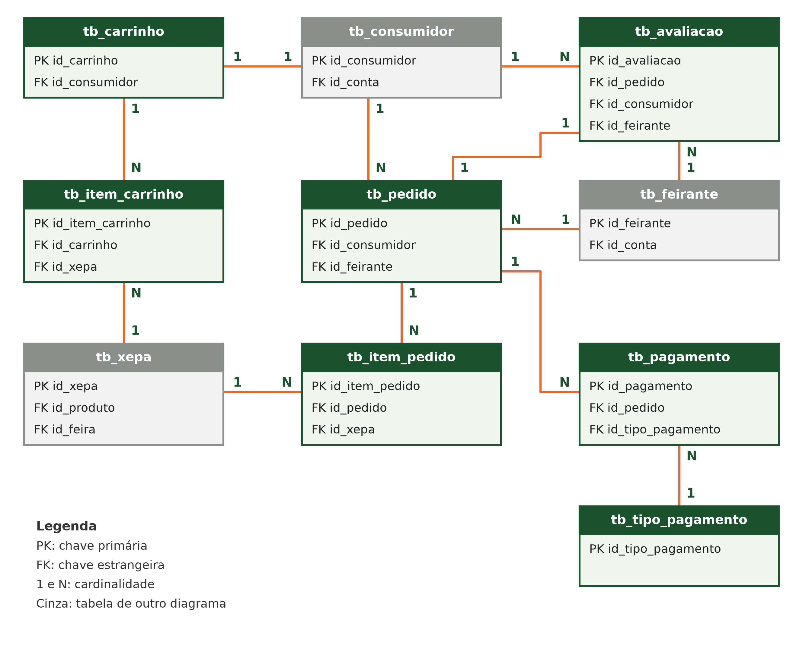

<p align="center">
  <picture>
    <source media="(prefers-color-scheme: dark)" srcset="assets/logo-texto-branca.png">
    
  </picture>
</p>

# Tecnologias

<br>

# 1. Banco de dados

O banco de dados do Xepa+ foi implementado em MySQL 8 pelo script xepaDB 1.0 e é acessado pelo back-end em Java com Spring Boot, por meio de uma API REST. O banco possui 25 tabelas, organizadas em cinco grupos: contas e acesso, feiras e ofertas, compra, comunicação, e receitas e financeiro.

## 1.1 Estratégia de dados

- Dados de conta: identificação, contato e perfil de acesso de consumidores e feirantes.
- Dados de operação: feiras, xepas, pedidos, pagamentos e conversas.
- Dados de gestão: gastos por categoria, vendas e plano de cada feirante.
- Indicadores: volume de vendas, comissões, recompra, produtos mais vendidos e alimentos aproveitados.
- Proteção: senhas com hash, acesso por perfil, coleta apenas do necessário e atendimento à LGPD.
- Dados de pagamento: o Xepa+ guarda apenas o método, o valor e o status, sem armazenar dados de cartão.
- Integridade: o controle de versão da xepa impede que a mesma unidade seja vendida duas vezes, e o preço de cada item fica registrado no momento da compra.

## 1.2 Tabelas do banco de dados

| Tabela | Principais campos | Finalidade |
| :--- | :--- | :--- |
| **tb_conta** | id_conta (PK), nome_conta, cpf_conta, email_conta, senha_conta (hash), telefone_conta, ativo, data_cadastro | Contas de acesso de todos os usuários |
| **tb_consumidor** | id_consumidor (PK), id_conta (FK) | Perfil de consumidor da conta |
| **tb_feirante** | id_feirante (PK), id_conta (FK), id_plano (FK), nome_fantasia, cnpj_feirante, ccm_feirante, matricula_feirante, grupo_comercio | Dados comerciais do feirante |
| **tb_colaborador** | id_colaborador (PK), id_conta (FK) | Equipe do Xepa+ que administra a plataforma |
| **tb_plano** | id_plano (PK), id_colaborador (FK), nome_plano, descricao_plano, valor_plano, ativo | Planos Semente, Broto e Colheita |
| **tb_dispositivo_sessao** | id_dispositivo (PK), id_conta (FK), nome_aparelho, token_hash, expira_em, ultimo_acesso, revogado | Aparelhos conectados e sessões |
| **tb_feira** | id_feira (PK), nome_feira, endereco_feira, cep_feira, cidade_feira, uf_feira, dia_semana, horario_inicio, horario_fim, latitude, longitude | Feiras exibidas no mapa |
| **tb_feirante_feira** | id_feirante (PK, FK), id_feira (PK, FK) | Feiras em que cada feirante trabalha |
| **tb_categoria** | id_categoria (PK), nome_categoria | Categorias de produtos |
| **tb_produto** | id_produto (PK), id_feirante (FK), id_categoria (FK), nome_produto, descricao_produto, imagem_produto, unidade_medida, preco_referencia, ativo | Catálogo de produtos do feirante |
| **tb_xepa** | id_xepa (PK), id_produto (FK), id_feira (FK), quantidade_xepa, preco_xepa, validade_xepa, data_retirada, horario_retirada_inicio, horario_retirada_fim, status_xepa, versao | Ofertas à venda e janela de retirada |
| **tb_carrinho** | id_carrinho (PK), id_consumidor (FK), data_criacao | Carrinho do consumidor |
| **tb_item_carrinho** | id_item_carrinho (PK), id_carrinho (FK), id_xepa (FK), quantidade_item | Itens do carrinho |
| **tb_pedido** | id_pedido (PK), id_consumidor (FK), id_feirante (FK), data_pedido, status_pedido, valor_total, codigo_retirada | Pedidos, um por feirante |
| **tb_item_pedido** | id_item_pedido (PK), id_pedido (FK), id_xepa (FK), quantidade_item, preco_unitario | Itens e preço no momento da compra |
| **tb_tipo_pagamento** | id_tipo_pagamento (PK), metodo_pagamento | Pix, cartão de crédito, cartão de débito e dinheiro |
| **tb_pagamento** | id_pagamento (PK), id_pedido (FK), id_tipo_pagamento (FK), valor_pagamento, status_pagamento, id_transacao_gateway, data_pagamento | Tentativas e situação do pagamento |
| **tb_avaliacao** | id_avaliacao (PK), id_pedido (FK), id_consumidor (FK), id_feirante (FK), nota, comentario | Avaliação do pedido (nota de 1 a 5) |
| **tb_chat** | id_chat (PK), id_consumidor (FK), id_feirante (FK), data_inicio | Conversa entre consumidor e feirante |
| **tb_mensagem** | id_mensagem (PK), id_chat (FK), id_conta (FK), texto_mensagem, data_envio, lida | Mensagens de cada conversa |
| **tb_mensagem_ia** | id_mensagem_ia (PK), id_conta (FK), papel, texto_mensagem_ia, data_envio | Conversas com a Xep.AI |
| **tb_receita_culinaria** | id_receita (PK), titulo_receita, imagem_receita, modo_preparo, tempo_preparo | Receitas sugeridas ao consumidor |
| **tb_ingrediente_receita** | id_ingrediente (PK), id_receita (FK), id_categoria (FK), nome_ingrediente, quantidade_ingrediente | Ingredientes ligados às categorias de xepa |
| **tb_categoria_gasto** | id_categoria_gasto (PK), nome_categoria_gasto, descricao_categoria_gasto | Tipos de gasto do feirante |
| **tb_gasto** | id_gasto (PK), id_feirante (FK), id_categoria_gasto (FK), valor_gasto, data_gasto, descricao_gasto | Despesas do feirante |

## 1.3 Relacionamentos

- Uma conta pode ter um perfil de consumidor, um de feirante e um de colaborador, cada um em relação 1:1.
- Uma conta possui vários dispositivos de sessão.
- Um colaborador cadastra vários planos, e um plano pode ser contratado por vários feirantes.
- Um feirante trabalha em várias feiras e uma feira reúne vários feirantes, relação registrada em tb_feirante_feira.
- Um feirante cadastra vários produtos; cada produto pertence a uma categoria e pode gerar várias xepas, cada uma ligada a uma feira.
- Cada consumidor tem um carrinho com vários itens; no checkout, o carrinho é dividido em um pedido por feirante.
- Um pedido possui vários itens, um ou mais pagamentos e, no máximo, uma avaliação.
- Um chat liga um consumidor a um feirante e possui várias mensagens; as conversas com a Xep.AI ficam ligadas à conta.
- Uma receita possui vários ingredientes, que podem estar ligados a uma categoria de produto.
- Um feirante registra vários gastos, cada um em uma categoria de gasto.

## 1.4 Diagrama do banco de dados

<p align="center">
  
</p>

<p align="center"><sub>Figura 1 – Diagrama do banco: contas, feiras e ofertas</sub></p>

<p align="center">
  
</p>

<p align="center"><sub>Figura 2 – Diagrama do banco: compra e pagamento</sub></p>

<p align="center">
  
</p>

<p align="center"><sub>Figura 3 – Diagrama do banco: comunicação, receitas e financeiro</sub></p>

<br>

# 2. Back-end em Java

A API do Xepa+ é escrita em Java 17 com Spring Boot e organizada em camadas. Cada requisição do front-end entra por um controller, passa pelas regras de negócio no service e chega ao banco por meio dos repositórios do Spring Data JPA. O front-end não acessa o banco diretamente.

## 2.1 Arquitetura em camadas

| Camada | Responsabilidade | Exemplos |
| :--- | :--- | :--- |
| **Front-end (React)** | Telas do consumidor e do feirante; envia requisições HTTP com JSON. | Área do consumidor e área do feirante |
| **Controller** | Recebe a requisição, valida a entrada e devolve a resposta. | AuthController, FeiraController, FinanceiroController |
| **Service** | Regras de negócio e transações (@Transactional). | AuthService, FeiraService, FinanceiroService |
| **Repository** | Consultas ao banco com Spring Data JPA. | ContaRepository, FeiranteRepository, FeiraRepository |
| **Entidades e MySQL** | Classes @Entity mapeadas para as tabelas tb_* do banco. | Conta, Feirante, Feira, Produto, Xepa, Pedido |

## 2.2 Tecnologias do back-end

| Tecnologia | Para que é usada |
| :--- | :--- |
| **Java 17** | Linguagem da aplicação do servidor. |
| **Spring Boot** | Inicialização e configuração da API. |
| **Spring Web MVC** | Criação dos endpoints HTTP/REST. |
| **Spring Data JPA e Hibernate** | Persistência e consultas às entidades do banco. |
| **MySQL Connector/J** | Comunicação JDBC com o MySQL. |
| **Lombok** | Geração de getters e setters nas entidades. |
| **Maven Wrapper** | Build, dependências e execução do projeto. |
| **PBKDF2 com HMAC-SHA-256** | Hash das senhas antes de gravar no banco. |
| **JUnit e H2** | Testes automatizados da API com banco em memória. |

## 2.3 Estrutura de pacotes

```text
br.com.xepamais.api
├── ApiApplication          // inicia a API
├── auth                    // cadastro, login e hash de senha
│   └── dto                 // requisições e respostas de cadastro e login
├── feira                   // feiras próximas e feiras do feirante
├── financeiro              // lucros, gastos, resumo, histórico e planilha CSV
├── admin                   // painel da equipe Xepa+
├── config                  // CORS para o front-end
└── database
    ├── model               // entidades JPA
    └── repository          // interfaces Spring Data JPA
```

## 2.4 Exemplo de entidade

```text
@Entity
@Table(name = "tb_xepa")
@Getter @Setter
public class Xepa {
    @Id
    @GeneratedValue(strategy = GenerationType.IDENTITY)
    @Column(name = "id_xepa")
    private Integer id;

    @ManyToOne
    @JoinColumn(name = "id_produto", nullable = false)
    private Produto produto;

    @ManyToOne
    @JoinColumn(name = "id_feira", nullable = false)
    private Feira feira;

    @Column(name = "preco_xepa", precision = 10, scale = 2)
    private BigDecimal preco;

    @Version   // impede vender a mesma unidade duas vezes
    private Integer versao;
}
```

## 2.5 Regras de integridade

| Regra | Como funciona |
| :--- | :--- |
| **Controle de versão da xepa** | O campo versao com @Version faz o Hibernate recusar duas compras simultâneas da mesma unidade. |
| **Preço no momento da compra** | preco_unitario em tb_item_pedido guarda o preço no momento da compra. |
| **Um pedido por feirante** | No checkout, o carrinho é dividido em pedidos separados, cada um com seu código de retirada. |
| **Transações** | Cadastro e operações financeiras rodam em @Transactional: ou tudo é gravado, ou nada. |
| **Senhas** | Nunca voltam nas respostas da API; ficam só como hash PBKDF2. |
| **Pagamento** | Só método, valor, status e id da transação do gateway; nenhum dado de cartão. |

O pedido passa pelas situações: aguardando pagamento, pago, pronto para retirada, retirado ou cancelado.

<br>

# 3. Endpoints REST planejados

| Método | Endpoint | Finalidade | Acesso |
| :--- | :--- | :--- | :--- |
| **POST** | /api/auth/cadastro | Criar conta | Público |
| **POST** | /api/auth/login | Entrar | Público |
| **GET, PUT** | /api/usuarios/me | Consultar e editar perfil | Logado |
| **GET** | /api/planos | Listar planos | Público |
| **PUT** | /api/feirantes/me/plano | Alterar o plano | Feirante |
| **GET** | /api/feiras | Listar feiras do mapa | Público |
| **POST, PUT, DELETE** | /api/feirantes/me/feiras | Gerenciar suas feiras | Feirante |
| **GET** | /api/xepas | Listar ofertas | Público |
| **POST** | /api/xepas | Cadastrar oferta | Feirante |
| **GET** | /api/xepas/{id} | Consultar oferta | Público |
| **PUT, DELETE** | /api/xepas/{id} | Alterar ou remover oferta | Feirante |
| **GET, POST** | /api/pedidos | Consultar e criar pedidos | Consumidor |
| **GET** | /api/feirantes/me/vendas | Consultar vendas | Feirante |
| **PATCH** | /api/pedidos/{id}/status | Atualizar situação | Feirante |
| **POST** | /api/pedidos/{id}/pagamento | Registrar pagamento | Consumidor |
| **GET, POST** | /api/financeiro/gastos | Consultar e registrar gastos | Feirante |
| **GET, POST** | /api/financeiro/lancamentos | Consultar e registrar rendas | Feirante |
| **GET** | /api/financeiro/resumo | Consultar indicadores | Feirante |
| **GET** | /api/conversas | Listar conversas | Logado |
| **GET, POST** | /api/conversas/{id}/mensagens | Ler e enviar mensagens | Logado |
| **POST** | /api/ia/mensagens | Conversar com a Xep.AI | Feirante |

Ajustes previstos: incluir a comissão de cada plano (15%, 8% e 5%) e o valor da comissão no pedido, criar tabelas de rendas do feirante, itens da cesta, consentimento da LGPD e recuperação de senha.

## 3.1 Dados iniciais (seed)

O script já insere os meios de pagamento, as categorias de produtos e as categorias de gastos. As 975 feiras virão da lista oficial da Prefeitura de São Paulo, já usada no mapa do site, e os feirantes, consumidores, xepas e pedidos serão fictícios, simulando o piloto na Brasilândia e na Freguesia do Ó.

## 3.2 Hospedagem da API

A API e o MySQL rodam em uma instância Amazon EC2 (t3.small) com disco EBS de 30 GB, IP fixo e snapshots para backup. A aplicação é empacotada pelo Maven e executada como serviço no servidor, com as credenciais do banco em variáveis de ambiente.

<br>

# 4. Requisitos técnicos da plataforma

O desenvolvimento do Xepa+ considera os recursos necessários para disponibilizar a plataforma na internet, manter suas funcionalidades e permitir futuras melhorias.

| Área | Requisitos |
| :--- | :--- |
| **Desenvolvimento** | Front-end: React, JavaScript, HTML e CSS.<br>Back-end: Java com Spring Boot.<br>APIs: integração entre front-end e back-end por endpoints REST.<br>Arquitetura: código organizado, modularizado e reutilizável. |
| **Banco de dados** | MySQL.<br>Persistência: armazenamento e recuperação dos dados entre sessões.<br>Modelagem: tabelas, chaves primárias, chaves estrangeiras e relacionamentos.<br>Seed: dados de teste para simular situações reais. |
| **Infraestrutura e hospedagem** | Hospedagem: Amazon EC2 (AWS), servidor em nuvem compatível com React, Java e MySQL.<br>Domínio: endereço personalizado para acessar o Xepa+.<br>Armazenamento: espaço para banco de dados, imagens e arquivos.<br>Backups: cópias de segurança para recuperação dos dados.<br>Publicação: aplicação disponível na internet. |
| **Integrações** | Pagamentos: possibilidade de integração com Pix e outros meios de pagamento.<br>Mapas: localização das feiras e dos feirantes.<br>Serviços externos: integração com APIs necessárias às funcionalidades da plataforma.<br>Inteligência artificial: API Gemini, utilizada na criação da Xep.AI (Xepinha). |
| **Testes e qualidade** | Testes funcionais: validação das principais funcionalidades.<br>Tratamento de erros: mensagens adequadas para falhas de conexão e operações.<br>Validação de dados: verificação das informações enviadas pelos usuários.<br>Desempenho: consultas eficientes e planejamento para crescimento da plataforma. |
| **Documentação e versionamento** | Git e GitHub: controle de versões e armazenamento do código-fonte.<br>Figma: protótipos e design das telas antes do desenvolvimento.<br>README: instruções de instalação, execução e tecnologias utilizadas.<br>Documentação técnica: arquitetura, banco de dados e endpoints.<br>Dossiê: registro dos conceitos, funcionalidades e decisões do projeto. |
| **Apresentação do projeto** | Agregador de links: página com acesso à plataforma, ao GitHub e às redes sociais.<br>QR Code: acesso direto ao agregador de links.<br>Demonstração: sistema publicado e funcional durante a apresentação. |

<br>

# 5. Segurança, privacidade e acessibilidade

## 5.1 Segurança

- Autenticação: login e controle de acesso por perfil.
- Proteção de dados: armazenamento seguro de credenciais e informações pessoais.
- Senhas e tokens de sessão são guardados como hash, e o site usa HTTPS.
- O Xepa+ não armazena dados de cartão.

## 5.2 Privacidade e LGPD

O Xepa+ segue a Lei nº 13.709/2018 (LGPD), coletando apenas os dados necessários e informando a finalidade de cada um.

| Dado | Finalidade | Base legal |
| :--- | :--- | :--- |
| **Nome, e-mail, telefone, CPF e senha (hash)** | Criar a conta, dar acesso e permitir o pagamento via Pix | Execução de contrato |
| **Dados do feirante (nome fantasia, CNPJ, matrícula)** | Identificar o feirante e verificar se atua de forma regular | Execução de contrato e legítimo interesse |
| **Pedidos e pagamentos** | Processar a compra, calcular a comissão e cumprir obrigações fiscais | Execução de contrato e obrigação legal |
| **Mensagens do chat e da Xep.AI** | Comunicação sobre pedidos e respostas ao feirante | Execução de contrato |
| **Aparelhos e sessões** | Manter o acesso seguro e permitir desconectar aparelhos | Legítimo interesse |
| **E-mail para novidades** | Marketing | Consentimento (opcional) |

No cadastro, o usuário marca a caixa “Li e aceito os Termos de Uso e a Política de Privacidade”.

## 5.3 Acessibilidade

Parte do público tem pouca familiaridade com ferramentas digitais. Por isso, o site já conta com o widget de acessibilidade UserWay, rótulos nos formulários, textos alternativos nas imagens, atributos ARIA, layout responsivo e vídeos que respeitam a preferência por menos movimento.

<br>

---

<p align="center"><a href="08-financeiro.md">← 8. Financeiro</a></p>
