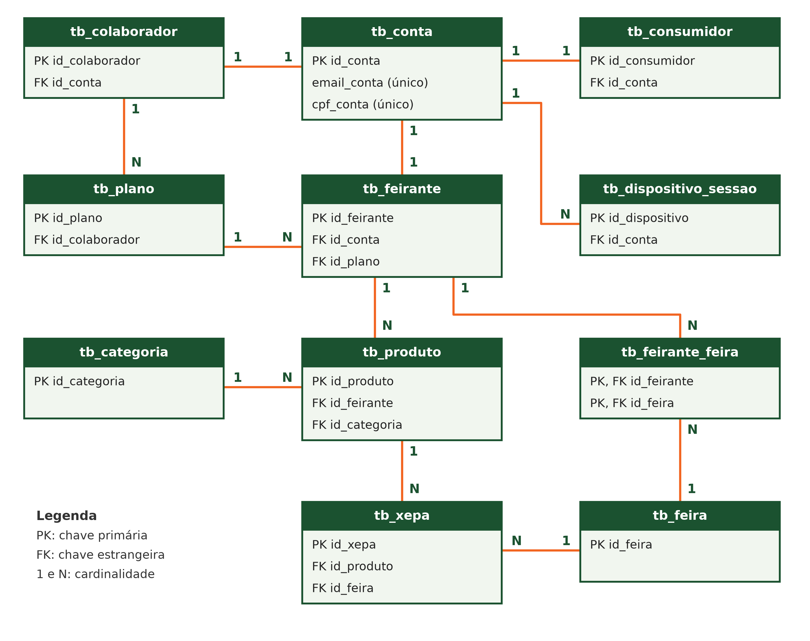
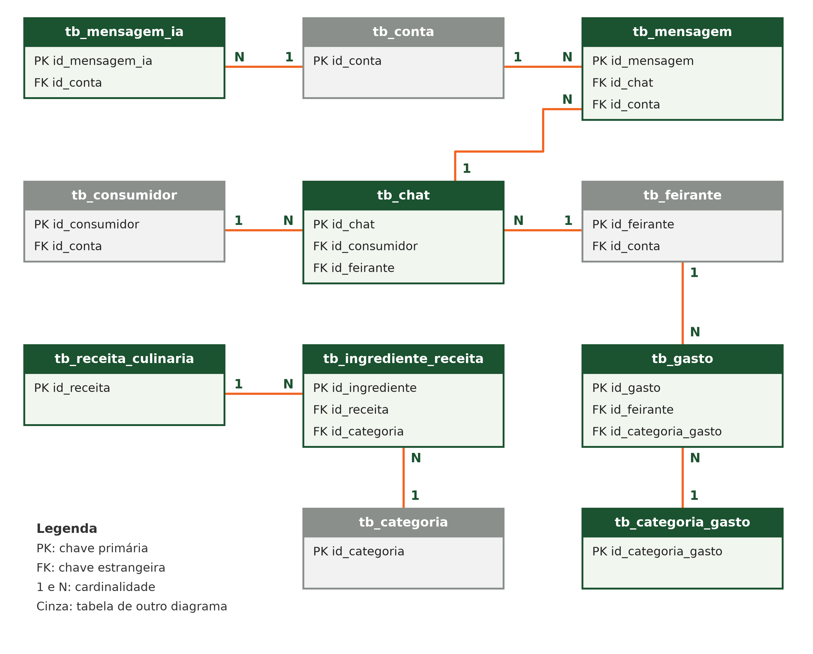

<p align="center">
  <picture>
    <source media="(prefers-color-scheme: dark)" srcset="assets/logo-texto-branca.png">
    
  </picture>
</p>

# Tecnologias

<br>

# 1. Banco de dados

O banco de dados do Xepa+ foi implementado em MySQL 8 e é acessado só pelo back-end em Java com Spring Boot, por meio de uma API REST. O banco tem **36 tabelas e 1 view**, com 53 chaves estrangeiras e 35 regras de validação (`CHECK`), organizadas em sete grupos: contas e acesso, feiras e feirantes, ofertas, compra e pagamento, comunicação, financeiro e receitas.

Os scripts (estrutura, dados de referência, feiras reais e dados de demonstração) e o **dicionário de dados completo** (cada tabela, campo, tipo, chave e regra) estão no [repositório database](https://github.com/XepaMais/database).

## 1.1 Estratégia de dados

- Dados de conta: identificação, contato e perfil de acesso de consumidores e feirantes.
- Dados de operação: feiras, xepas, pedidos, pagamentos e conversas.
- Dados de gestão: gastos por categoria, vendas e plano de cada feirante.
- Indicadores: volume de vendas, comissões, recompra, produtos mais vendidos e alimentos aproveitados.
- Proteção: senhas com hash, acesso por perfil, coleta apenas do necessário e atendimento à LGPD.
- Dados de pagamento: o Xepa+ guarda apenas o método, o valor e o status, sem armazenar dados de cartão.
- Integridade: o controle de versão da xepa impede que a mesma unidade seja vendida duas vezes, e o preço de cada item fica registrado no momento da compra.

## 1.2 Tabelas do banco de dados

| Grupo | Tabelas | Finalidade |
| :--- | :--- | :--- |
| **Contas e acesso** | tb_conta, tb_consumidor, tb_feirante, tb_colaborador, tb_dispositivo_sessao, tb_endereco, tb_imagem | Quem usa o Xepa+, login por aparelho, fotos e registro do aceite da LGPD |
| **Feiras e feirantes** | tb_plano, tb_feira, tb_feira_dia, tb_feirante_feira, tb_funcionario_feira | Planos, feiras com dias e horários, onde cada feirante trabalha |
| **Ofertas** | tb_categoria, tb_produto, tb_xepa | Produtos do feirante e as xepas à venda, com preço, quantidade e janela de retirada |
| **Compra e pagamento** | tb_carrinho, tb_item_carrinho, tb_pedido, tb_item_pedido, tb_tipo_pagamento, tb_pagamento, tb_entrega, tb_avaliacao | Do carrinho ao pedido pago, retirado e avaliado |
| **Comunicação** | tb_chat, tb_mensagem, tb_conversa_ia, tb_mensagem_ia, tb_mensagem_suporte | Chat consumidor-feirante, Xepinha e suporte |
| **Financeiro** | tb_origem_renda, tb_renda, tb_categoria_despesa, tb_despesa, tb_saque, vw_saldo_feirante (view) | Lucros, gastos, saques e saldo do feirante |
| **Receitas** | tb_categoria_receita, tb_receita_culinaria, tb_ingrediente_receita | Receitas para aproveitar a xepa |

## 1.3 Relacionamentos

- Uma conta pode ter um perfil de consumidor, um de feirante e um de colaborador, cada um em relação 1:1.
- Uma conta possui vários dispositivos de sessão.
- Um colaborador cadastra vários planos, e um plano pode ser contratado por vários feirantes.
- Um feirante trabalha em várias feiras e uma feira reúne vários feirantes, relação registrada em tb_feirante_feira.
- Um feirante cadastra vários produtos; cada produto pertence a uma categoria e pode gerar várias xepas, cada uma ligada a uma feira.
- Cada consumidor tem um carrinho com vários itens; no checkout, o carrinho é dividido em um pedido por feirante.
- Um pedido possui vários itens, um ou mais pagamentos e, no máximo, uma avaliação.
- Um chat liga um consumidor a um feirante e possui várias mensagens; as conversas com a Xep.AI ficam ligadas à conta.
- Uma receita possui vários ingredientes, que podem estar ligados a uma categoria de produto.
- Um feirante registra vários gastos, cada um em uma categoria de gasto.

## 1.4 Diagrama do banco de dados

<p align="center">
  
</p>

<p align="center"><sub>Figura 1 – Diagrama do banco: contas, feiras e ofertas</sub></p>

<p align="center">
  
</p>

<p align="center"><sub>Figura 2 – Diagrama do banco: compra e pagamento</sub></p>

<p align="center">
  
</p>

<p align="center"><sub>Figura 3 – Diagrama do banco: comunicação, receitas e financeiro</sub></p>

<br>

# 2. Back-end em Java

A API do Xepa+ é escrita em Java 17 com Spring Boot e organizada em camadas. Cada requisição do front-end entra por um controller, passa pelas regras de negócio no service e chega ao banco por meio dos repositórios do Spring Data JPA. O front-end não acessa o banco diretamente.

## 2.1 Arquitetura em camadas

| Camada | Responsabilidade | Exemplos |
| :--- | :--- | :--- |
| **Front-end (React)** | Telas do consumidor e do feirante; envia requisições HTTP com JSON. | Área do consumidor e área do feirante |
| **Controller** | Recebe a requisição, valida a entrada e devolve a resposta. | AuthController, FeiraController, FinanceiroController |
| **Service** | Regras de negócio e transações (@Transactional). | AuthService, FeiraService, FinanceiroService |
| **Repository** | Consultas ao banco com Spring Data JPA. | ContaRepository, FeiranteRepository, FeiraRepository |
| **Entidades e MySQL** | Classes @Entity mapeadas para as tabelas tb_* do banco. | Conta, Feirante, Feira, Produto, Xepa, Pedido |

## 2.2 Tecnologias do back-end

| Tecnologia | Para que é usada |
| :--- | :--- |
| **Java 17** | Linguagem da aplicação do servidor. |
| **Spring Boot** | Inicialização e configuração da API. |
| **Spring Web MVC** | Criação dos endpoints HTTP/REST. |
| **Spring Data JPA e Hibernate** | Persistência e consultas às entidades do banco. |
| **MySQL Connector/J** | Comunicação JDBC com o MySQL. |
| **Lombok** | Geração de getters e setters nas entidades. |
| **Maven Wrapper** | Build, dependências e execução do projeto. |
| **PBKDF2 com HMAC-SHA-256** | Hash das senhas antes de gravar no banco. |
| **JUnit e H2** | Testes automatizados da API com banco em memória. |

## 2.3 Estrutura de pacotes

```text
br.com.xepamais.api
├── ApiApplication          // inicia a API
├── auth                    // cadastro, login e hash de senha
│   └── dto                 // requisições e respostas de cadastro e login
├── feira                   // feiras próximas e feiras do feirante
├── financeiro              // lucros, gastos, resumo, histórico e planilha CSV
├── admin                   // painel da equipe Xepa+
├── config                  // CORS para o front-end
└── database
    ├── model               // entidades JPA
    └── repository          // interfaces Spring Data JPA
```

## 2.4 Exemplo de entidade

```text
@Entity
@Table(name = "tb_xepa")
@Getter @Setter
public class Xepa {
    @Id
    @GeneratedValue(strategy = GenerationType.IDENTITY)
    @Column(name = "id_xepa")
    private Integer id;

    @ManyToOne
    @JoinColumn(name = "id_produto", nullable = false)
    private Produto produto;

    @ManyToOne
    @JoinColumn(name = "id_feira", nullable = false)
    private Feira feira;

    @Column(name = "preco_xepa", precision = 10, scale = 2)
    private BigDecimal preco;

    @Version   // impede vender a mesma unidade duas vezes
    private Integer versao;
}
```

## 2.5 Regras de integridade

| Regra | Como funciona |
| :--- | :--- |
| **Controle de versão da xepa** | O campo versao com @Version faz o Hibernate recusar duas compras simultâneas da mesma unidade. |
| **Preço no momento da compra** | preco_unitario em tb_item_pedido guarda o preço no momento da compra. |
| **Um pedido por feirante** | No checkout, o carrinho é dividido em pedidos separados, cada um com seu código de retirada. |
| **Transações** | Cadastro e operações financeiras rodam em @Transactional: ou tudo é gravado, ou nada. |
| **Senhas** | Nunca voltam nas respostas da API; ficam só como hash PBKDF2. |
| **Pagamento** | Só método, valor, status e id da transação do gateway; nenhum dado de cartão. |

O pedido passa pelas situações: aguardando pagamento, pago, pronto para retirada, retirado ou cancelado.

<br>

# 3. Endpoints REST

A documentação interativa de todos os endpoints (parâmetros, respostas, códigos de erro e autenticação) fica no **Swagger**: [xepamais.com.br/api/docs](https://xepamais.com.br/api/docs). O README do [repositório backend](https://github.com/XepaMais/backend) tem a lista completa.

| Grupo | Endpoints principais | Acesso |
| :--- | :--- | :--- |
| **Autenticação** | `POST /api/auth/cadastro-consumidor`, `POST /api/auth/cadastro-feirante`, `POST /api/auth/login` | Público |
| **Catálogo e mapa** | `GET /api/xepas`, `GET /api/xepas/{id}`, `GET /api/feiras`, `GET /api/feiras/proximas`, `GET /api/planos`, `GET /api/receitas` | Público |
| **Conta e LGPD** | `GET/PUT /api/conta/{id}/perfil`, `PUT .../senha`, `GET .../dispositivos`, `GET .../dados`, `GET/PUT .../consentimento`, `DELETE /api/conta/{id}` | Dono da conta |
| **Consumidor** | `/api/consumidor/{id}/carrinho`, `.../endereco`, `.../pedidos`, `.../impacto` | Consumidor |
| **Feirante** | `/api/feirante/{id}/xepas`, `/api/feiras/feirante/{id}`, `/api/feirante/{id}/pedidos`, `/api/feirante/{id}/plano` | Feirante |
| **Financeiro** | `/api/financeiro/{id}/rendas`, `.../despesas`, `.../saldo`, `.../saques`, `.../resumo`, `.../historico`, `.../planilha` | Feirante |
| **Conversas e IA** | `/api/{consumidor\|feirante}/{id}/conversas`, `/api/feirante/{id}/xepinha/mensagens` | Dono da conta |

**Como funciona o acesso:**
- O login devolve um **token**, enviado no cabeçalho `Authorization: Bearer <token>`.
- Rotas com `{id}` só respondem ao dono da conta: `401` significa sessão expirada e `403` significa conta de outra pessoa.
- Todo erro volta no mesmo formato: `{ status, erro, message, caminho, momento }`.

## 3.1 Dados iniciais (seed)

O banco é alimentado por três scripts de seed, explicados no [repositório database](https://github.com/XepaMais/database):
- **Dados de referência:** formas de pagamento, categorias, origens de renda, planos e receitas.
- **Feiras reais** da região do piloto (Freguesia do Ó, Brasilândia e Pirituba) e da Zona Oeste, com dias, horários e coordenadas.
- **Dados de demonstração fictícios**, gerados por script com base na pesquisa de campo:
  - 10 feirantes e 30 consumidores;
  - 60 xepas e 40 pedidos em todas as situações;
  - pagamentos, financeiro, conversas e avaliações.

As datas são relativas a "hoje", então sempre há xepas à venda. Um script de limpeza remove só os dados fictícios.

## 3.2 Hospedagem da API

A API e o MySQL rodam em uma instância Amazon EC2 com disco EBS, IP fixo e snapshots para backup.
- A API é empacotada pelo Maven e executada como serviço no servidor, com as credenciais em variáveis de ambiente.
- Ela fica atrás do **Nginx com HTTPS** (certificado Let's Encrypt) em `api.xepamais.com.br` e só ouve dentro do servidor.
- O site React fica na **Vercel**, que repassa as chamadas `/api` para a API por HTTPS.

O plano para suportar muito mais usuários está em [10. Escalabilidade](10-escalabilidade.md).

<br>

# 4. Requisitos técnicos da plataforma

O desenvolvimento do Xepa+ considera os recursos necessários para disponibilizar a plataforma na internet, manter suas funcionalidades e permitir futuras melhorias.

| Área | Requisitos |
| :--- | :--- |
| **Desenvolvimento** | Front-end: React, JavaScript, HTML e CSS.<br>Back-end: Java com Spring Boot.<br>APIs: integração entre front-end e back-end por endpoints REST.<br>Arquitetura: código organizado, modularizado e reutilizável. |
| **Banco de dados** | MySQL.<br>Persistência: armazenamento e recuperação dos dados entre sessões.<br>Modelagem: tabelas, chaves primárias, chaves estrangeiras e relacionamentos.<br>Seed: dados de teste para simular situações reais. |
| **Infraestrutura e hospedagem** | Hospedagem: Amazon EC2 (AWS), servidor em nuvem compatível com React, Java e MySQL.<br>Domínio: endereço personalizado para acessar o Xepa+.<br>Armazenamento: espaço para banco de dados, imagens e arquivos.<br>Backups: cópias de segurança para recuperação dos dados.<br>Publicação: aplicação disponível na internet. |
| **Integrações** | Pagamentos: possibilidade de integração com Pix e outros meios de pagamento.<br>Mapas: localização das feiras e dos feirantes.<br>Serviços externos: integração com APIs necessárias às funcionalidades da plataforma.<br>Inteligência artificial: API Gemini, utilizada na criação da Xep.AI (Xepinha). |
| **Testes e qualidade** | Testes funcionais: validação das principais funcionalidades.<br>Tratamento de erros: mensagens adequadas para falhas de conexão e operações.<br>Validação de dados: verificação das informações enviadas pelos usuários.<br>Desempenho: consultas eficientes e planejamento para crescimento da plataforma. |
| **Documentação e versionamento** | Git e GitHub: controle de versões e armazenamento do código-fonte.<br>Figma: protótipos e design das telas antes do desenvolvimento.<br>README: instruções de instalação, execução e tecnologias utilizadas.<br>Documentação técnica: arquitetura, banco de dados e endpoints.<br>Dossiê: registro dos conceitos, funcionalidades e decisões do projeto. |
| **Apresentação do projeto** | Agregador de links: página com acesso à plataforma, ao GitHub e às redes sociais.<br>QR Code: acesso direto ao agregador de links.<br>Demonstração: sistema publicado e funcional durante a apresentação. |

<br>

# 5. Segurança, privacidade e acessibilidade

## 5.1 Segurança

- Autenticação: login e controle de acesso por perfil.
- Proteção de dados: armazenamento seguro de credenciais e informações pessoais.
- Senhas e tokens de sessão são guardados como hash, e o site usa HTTPS.
- O Xepa+ não armazena dados de cartão.

## 5.2 Privacidade e LGPD

O Xepa+ segue a Lei nº 13.709/2018 (LGPD), coletando apenas os dados necessários e informando a finalidade de cada um.

| Dado | Finalidade | Base legal |
| :--- | :--- | :--- |
| **Nome, e-mail, telefone, CPF e senha (hash)** | Criar a conta, dar acesso e permitir o pagamento via Pix | Execução de contrato |
| **Dados do feirante (nome fantasia, CNPJ, matrícula)** | Identificar o feirante e verificar se atua de forma regular | Execução de contrato e legítimo interesse |
| **Pedidos e pagamentos** | Processar a compra, calcular a comissão e cumprir obrigações fiscais | Execução de contrato e obrigação legal |
| **Mensagens do chat e da Xep.AI** | Comunicação sobre pedidos e respostas ao feirante | Execução de contrato |
| **Aparelhos e sessões** | Manter o acesso seguro e permitir desconectar aparelhos | Legítimo interesse |
| **E-mail para novidades** | Marketing | Consentimento (opcional) |

**Consentimento e direitos do titular:**
- No cadastro, o aceite dos Termos de Uso e da Política de Privacidade é obrigatório, e a API grava a data e a versão aceita.
- O e-mail de novidades é opcional e pode ser desligado no perfil.
- Em **Perfil → Privacidade e dados**, a pessoa baixa todos os seus dados (JSON) ou exclui a conta. Na exclusão, os dados pessoais são anonimizados, e pedidos e pagamentos ficam guardados sem identificar a pessoa, por obrigação fiscal.

Política completa: [11. LGPD](11-lgpd.md).

## 5.3 Acessibilidade

Parte do público tem pouca familiaridade com ferramentas digitais. Por isso, o site já conta com o widget de acessibilidade UserWay, rótulos nos formulários, textos alternativos nas imagens, atributos ARIA, layout responsivo e vídeos que respeitam a preferência por menos movimento.

<br>

---

<p align="center"><a href="08-financeiro.md">← 8. Financeiro</a> · <a href="10-escalabilidade.md">10. Escalabilidade →</a></p>
