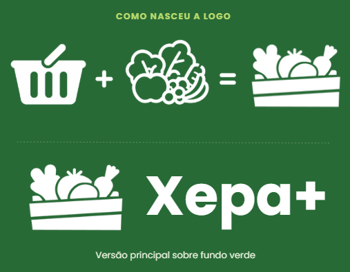
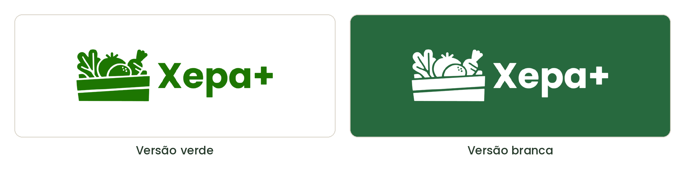
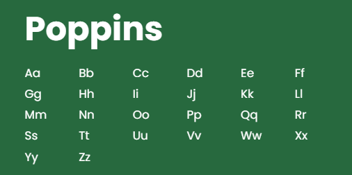
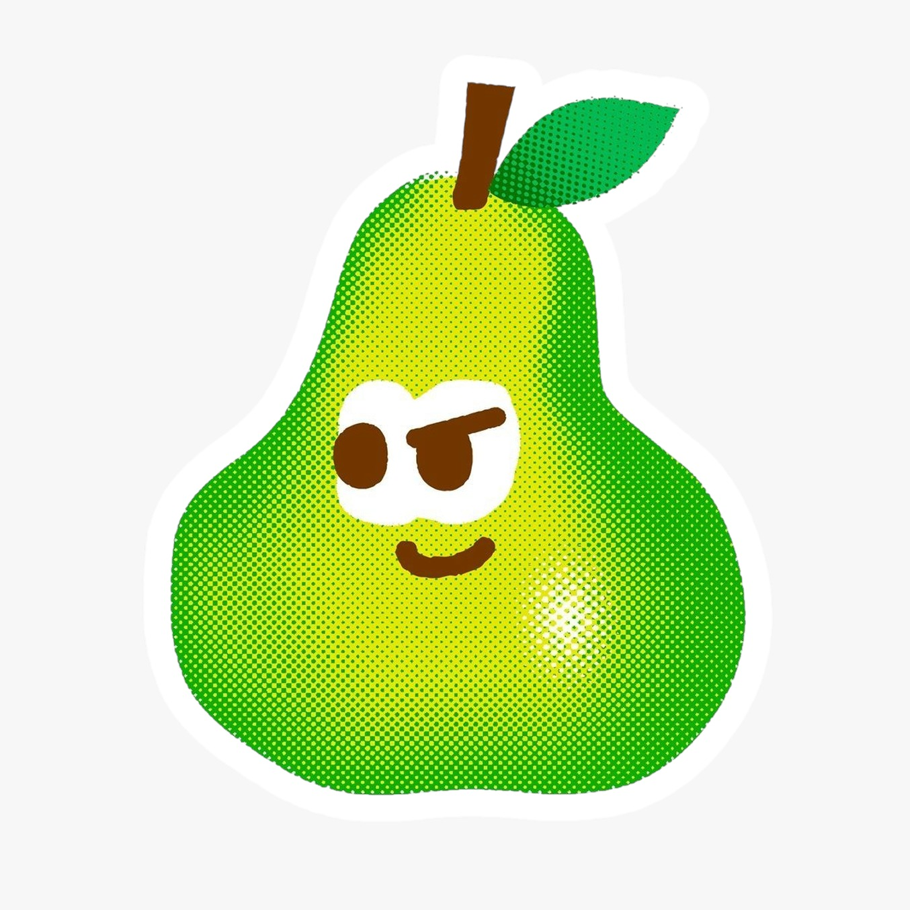

  

# Identidade Visual

**Sumário**

1. [Conceito](#1-conceito)
2. [Logotipo](#2-logotipo)
3. [Variações da Logo](#3-variações-da-logo)
4. [Paleta de Cores](#4-paleta-de-cores)
5. [Tipografia](#5-tipografia)
6. [Mascote](#6-mascote)

 

# 1. Conceito

A identidade visual do Xepa+ é inspirada na feira livre: o toldo listrado das barracas, os caixotes de madeira e as cores das frutas, verduras e legumes. Ela é aplicada às páginas e aos componentes da plataforma, aos materiais de divulgação e à apresentação, garantindo telas padronizadas e uma experiência de navegação consistente.

Slogan: **"Mais alimento, menos desperdício."**

 

# 2. Logotipo

**O nome:** une a palavra "xepa", que identifica os alimentos que permanecem nas feiras ao final do expediente, ao sinal "+", que representa transformação e benefício.

**A logo:** une a cesta de compras aos alimentos que seriam desperdiçados. O resultado é um caixote de feira cheio, que transmite três ideias: **reaproveitamento**, **economia** e **sustentabilidade**.

  

 

# 3. Variações da Logo

A logo tem duas variações: a verde, para fundos claros, e a branca, para fundos verdes ou escuros.

  

| Variação | Uso |
| :--- | :--- |
| **Verde** | Fundos claros: site, documentos e redes sociais. |
| **Branca** | Fundos verdes ou escuros: materiais da marca e apresentação. |

 

# 4. Paleta de Cores

| Cor | Código | Uso principal |
| :--- | :---: | :--- |
| **Verde** | `#27693E` | Cor principal: cabeçalho, botões e títulos. |
| **Laranja** | `#F76019` | Destaques, chamadas e botões de ação. |
| **Verde-amarelado** | `#9CB806` | Detalhes, etiquetas e item ativo do menu. |
| **Amarelo** | `#FFC927` | Apoio em ilustrações e destaques. |
| **Cinza-escuro** | `#161414` | Textos. |
| **Branco** | `#FFFFFF` | Fundos e textos sobre cores escuras. |

 

# 5. Tipografia

A fonte **Poppins** foi escolhida por seu estilo moderno, geométrico e de boa legibilidade. Junto com a paleta inspirada na feira, ela deixa a comunicação moderna, acolhedora e fácil de reconhecer, e é usada nos títulos e textos da plataforma, do dossiê e da apresentação.

  

 

# 6. Mascote

A **Xepinha**, mascote da assistente virtual Xep.AI, segue o mesmo estilo de frutas da identidade visual. Saiba mais em [Xep.AI (Xepinha)](xepinha.md).

  

