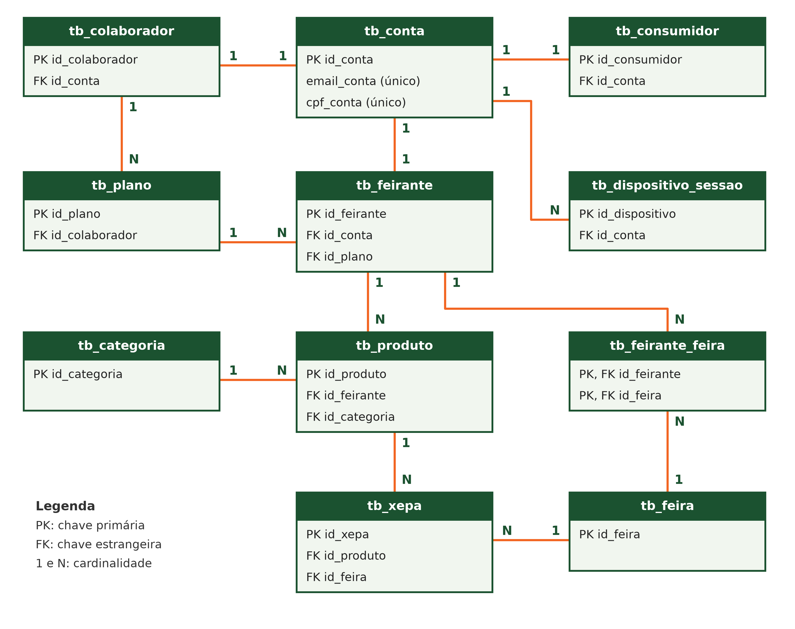
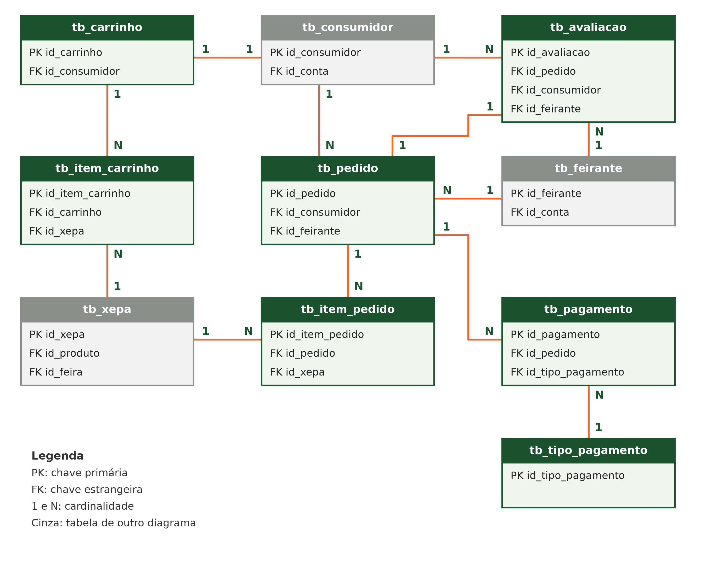
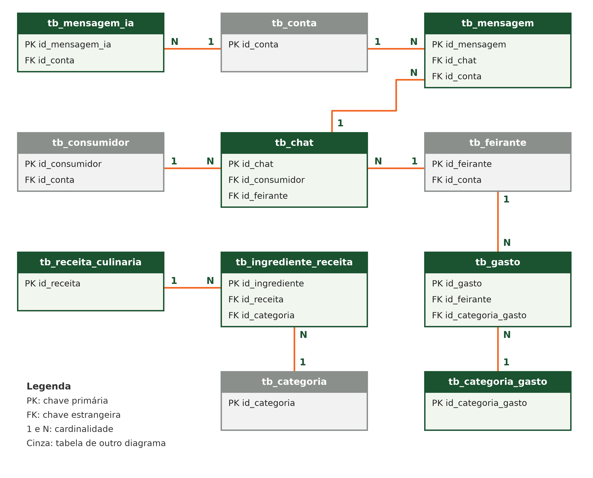

  <picture>
    <source media="(prefers-color-scheme: dark)" srcset="assets/logo-texto-branca.png">
    
  </picture>

# Tecnologias

**Sumário**

1. [Tecnologias](#1-tecnologias)
2. [Banco de Dados](#2-banco-de-dados)
3. [Estratégia de Dados](#3-estratégia-de-dados)
4. [Segurança e Privacidade](#4-segurança-e-privacidade)
5. [Infraestrutura](#5-infraestrutura)
6. [Acessibilidade](#6-acessibilidade)
7. [Testes, Documentação e Apresentação](#7-testes-documentação-e-apresentação)

 

# 1. Tecnologias

| Camada | Tecnologia |
|---|---|
| Front-end | React, JavaScript, HTML e CSS |
| Back-end | Java com Spring Boot |
| API | REST |
| Banco de dados | MySQL 8 |
| Inteligência artificial | API Gemini (Xep.AI) |
| Mapas | API de mapas (localização das feiras por CEP) |
| Pagamentos | Pix (integração com outros meios prevista) |
| Design e protótipos | Figma |
| Versionamento | Git e GitHub |
| Hospedagem | Amazon EC2 (AWS) |
| Fotos e e-mails | Amazon S3 + CloudFront e Amazon SES (a implementar) |
| Monitoramento | Amazon CloudWatch |
| Organização das tarefas | Trello |

A integração entre front-end e back-end é realizada por meio de endpoints REST, com código organizado, modularizado e reutilizável. Todos os integrantes participaram do desenvolvimento front-end utilizando React e Figma.

**Endpoints REST planejados:**

| Método | Endpoint | Finalidade | Acesso |
|---|---|---|---|
| POST | /api/auth/cadastro | Criar conta | Público |
| POST | /api/auth/login | Entrar | Público |
| GET, PUT | /api/usuarios/me | Consultar e editar perfil | Logado |
| GET | /api/planos | Listar planos | Público |
| PUT | /api/feirantes/me/plano | Alterar o plano | Feirante |
| GET | /api/feiras | Listar feiras do mapa | Público |
| POST, PUT, DELETE | /api/feirantes/me/feiras | Gerenciar suas feiras | Feirante |
| GET | /api/xepas | Listar ofertas | Público |
| POST | /api/xepas | Cadastrar oferta | Feirante |
| GET | /api/xepas/{id} | Consultar oferta | Público |
| PUT, DELETE | /api/xepas/{id} | Alterar ou remover oferta | Feirante |
| GET, POST | /api/pedidos | Consultar e criar pedidos | Consumidor |
| GET | /api/feirantes/me/vendas | Consultar vendas | Feirante |
| PATCH | /api/pedidos/{id}/status | Atualizar situação | Feirante |
| POST | /api/pedidos/{id}/pagamento | Registrar pagamento | Consumidor |
| GET, POST | /api/financeiro/gastos | Consultar e registrar gastos | Feirante |
| GET, POST | /api/financeiro/lancamentos | Consultar e registrar rendas | Feirante |
| GET | /api/financeiro/resumo | Consultar indicadores | Feirante |
| GET | /api/conversas | Listar conversas | Logado |
| GET, POST | /api/conversas/{id}/mensagens | Ler e enviar mensagens | Logado |
| POST | /api/ia/mensagens | Conversar com a Xep.AI | Feirante |

 

# 2. Banco de Dados

O banco de dados foi implementado em MySQL 8, por meio do script `xepaDB 1.0`. O banco possui 25 tabelas organizadas em cinco grupos:

- Contas e acesso.
- Feiras e ofertas.
- Compra.
- Comunicação.
- Receitas e financeiro.

O banco será acessado pelo back-end em Java com Spring Boot, por meio da API REST. Enquanto a API não é publicada, o front-end guarda os dados no navegador, por meio do `localStorage`.

**Principais relacionamentos:**

- Uma conta pode ter um perfil de consumidor, um de feirante e um de colaborador, cada um em relação 1:1.
- Um feirante trabalha em várias feiras, e uma feira reúne vários feirantes (`tb_feirante_feira`).
- Um feirante cadastra vários produtos; cada produto pode gerar várias xepas, cada uma ligada a uma feira.
- No checkout, o carrinho do consumidor é dividido em um pedido por feirante.
- Um chat liga um consumidor a um feirante; as conversas com a Xep.AI ficam ligadas à conta (`tb_mensagem_ia`).
- Um feirante registra vários gastos, cada um em uma categoria de gasto.

**Tabelas do banco de dados:**

| Tabela | Principais campos | Finalidade |
|---|---|---|
| `tb_conta` | id_conta (PK), nome_conta, cpf_conta, email_conta, senha_conta (hash), telefone_conta, ativo, data_cadastro | Contas de acesso de todos os usuários |
| `tb_consumidor` | id_consumidor (PK), id_conta (FK) | Perfil de consumidor da conta |
| `tb_feirante` | id_feirante (PK), id_conta (FK), id_plano (FK), nome_fantasia, cnpj_feirante, ccm_feirante, matricula_feirante, grupo_comercio | Dados comerciais do feirante |
| `tb_colaborador` | id_colaborador (PK), id_conta (FK) | Equipe do Xepa+ que administra a plataforma |
| `tb_plano` | id_plano (PK), id_colaborador (FK), nome_plano, descricao_plano, valor_plano, ativo | Planos Semente, Broto e Colheita |
| `tb_dispositivo_sessao` | id_dispositivo (PK), id_conta (FK), nome_aparelho, token_hash, expira_em, ultimo_acesso, revogado | Aparelhos conectados e sessões |
| `tb_feira` | id_feira (PK), nome_feira, endereco_feira, cep_feira, cidade_feira, uf_feira, dia_semana, horario_inicio, horario_fim, latitude, longitude | Feiras exibidas no mapa |
| `tb_feirante_feira` | id_feirante (PK, FK), id_feira (PK, FK) | Feiras em que cada feirante trabalha |
| `tb_categoria` | id_categoria (PK), nome_categoria | Categorias de produtos |
| `tb_produto` | id_produto (PK), id_feirante (FK), id_categoria (FK), nome_produto, descricao_produto, imagem_produto, unidade_medida, preco_referencia, ativo | Catálogo de produtos do feirante |
| `tb_xepa` | id_xepa (PK), id_produto (FK), id_feira (FK), quantidade_xepa, preco_xepa, validade_xepa, data_retirada, horario_retirada_inicio, horario_retirada_fim, status_xepa, versao | Ofertas à venda e janela de retirada |
| `tb_carrinho` | id_carrinho (PK), id_consumidor (FK), data_criacao | Carrinho do consumidor |
| `tb_item_carrinho` | id_item_carrinho (PK), id_carrinho (FK), id_xepa (FK), quantidade_item | Itens do carrinho |
| `tb_pedido` | id_pedido (PK), id_consumidor (FK), id_feirante (FK), data_pedido, status_pedido, valor_total, codigo_retirada | Pedidos, um por feirante |
| `tb_item_pedido` | id_item_pedido (PK), id_pedido (FK), id_xepa (FK), quantidade_item, preco_unitario | Itens e preço no momento da compra |
| `tb_tipo_pagamento` | id_tipo_pagamento (PK), metodo_pagamento | Pix, cartão de crédito, cartão de débito e dinheiro |
| `tb_pagamento` | id_pagamento (PK), id_pedido (FK), id_tipo_pagamento (FK), valor_pagamento, status_pagamento, id_transacao_gateway, data_pagamento | Tentativas e situação do pagamento |
| `tb_avaliacao` | id_avaliacao (PK), id_pedido (FK), id_consumidor (FK), id_feirante (FK), nota, comentario | Avaliação do pedido (nota de 1 a 5) |
| `tb_chat` | id_chat (PK), id_consumidor (FK), id_feirante (FK), data_inicio | Conversa entre consumidor e feirante |
| `tb_mensagem` | id_mensagem (PK), id_chat (FK), id_conta (FK), texto_mensagem, data_envio, lida | Mensagens de cada conversa |
| `tb_mensagem_ia` | id_mensagem_ia (PK), id_conta (FK), papel, texto_mensagem_ia, data_envio | Conversas com a Xep.AI |
| `tb_receita_culinaria` | id_receita (PK), titulo_receita, imagem_receita, modo_preparo, tempo_preparo | Receitas sugeridas ao consumidor |
| `tb_ingrediente_receita` | id_ingrediente (PK), id_receita (FK), id_categoria (FK), nome_ingrediente, quantidade_ingrediente | Ingredientes ligados às categorias de xepa |
| `tb_categoria_gasto` | id_categoria_gasto (PK), nome_categoria_gasto, descricao_categoria_gasto | Tipos de gasto do feirante |
| `tb_gasto` | id_gasto (PK), id_feirante (FK), id_categoria_gasto (FK), valor_gasto, data_gasto, descricao_gasto | Despesas do feirante |

**Diagramas do banco de dados** (PK: chave primária; FK: chave estrangeira; tabelas em cinza aparecem em outro diagrama):

  
   <em>Contas, feiras e ofertas</em>

  
   <em>Compra e pagamento</em>

  
   <em>Comunicação, receitas e financeiro</em>

**Dados iniciais (seed):** o script já insere os meios de pagamento, as categorias de produtos e as categorias de gastos. As 975 feiras virão da lista oficial da Prefeitura de São Paulo, já usada no mapa do site, e os feirantes, consumidores, xepas e pedidos serão fictícios, simulando o piloto na Brasilândia e na Freguesia do Ó.

**Ajustes previstos:** incluir a comissão de cada plano (15%, 8% e 5%) e o valor da comissão no pedido, criar tabelas de rendas do feirante, itens da cesta, consentimento da LGPD e recuperação de senha.

 

# 3. Estratégia de Dados

- **Contas:** identificação, contato e perfil de acesso de consumidores e feirantes.
- **Operação:** feiras, xepas, pedidos, pagamentos e conversas.
- **Gestão:** gastos por categoria, vendas e plano de cada feirante.
- **Indicadores:** volume de vendas, comissões, recompra, produtos mais vendidos e alimentos aproveitados.
- **Integridade:** o controle de versão da xepa impede que a mesma unidade seja vendida duas vezes, e o preço de cada item fica registrado no momento da compra.

 

# 4. Segurança e Privacidade

O projeto considera senhas armazenadas com hash, controle de acesso por perfil, coleta apenas dos dados necessários e tratamento adequado de dados pessoais conforme a LGPD (Lei nº 13.709/2018).

O Xepa+ guarda apenas o método, o valor e o status do pagamento, sem armazenar dados de cartão. O controle de versão da xepa busca impedir que a mesma unidade seja vendida duas vezes, e o preço de cada item fica registrado no momento da compra.

| Dado | Finalidade | Base legal |
|---|---|---|
| Nome, e-mail, telefone, CPF e senha (hash) | Criar a conta, dar acesso e permitir o pagamento via Pix | Execução de contrato |
| Dados do feirante (nome fantasia, CNPJ, matrícula) | Identificar o feirante e verificar se atua de forma regular | Execução de contrato e legítimo interesse |
| Pedidos e pagamentos | Processar a compra, calcular a comissão e cumprir obrigações fiscais | Execução de contrato e obrigação legal |
| Mensagens do chat e da Xep.AI | Comunicação sobre pedidos e respostas ao feirante | Execução de contrato |
| Aparelhos e sessões | Manter o acesso seguro e permitir desconectar aparelhos | Legítimo interesse |
| E-mail para novidades | Marketing | Consentimento (opcional) |

- Senhas e tokens de sessão são guardados como hash, e o site usa HTTPS.
- No cadastro, o usuário marca a caixa "Li e aceito os Termos de Uso e a Política de Privacidade".

- Os dados dos usuários não são vendidos a terceiros.

 

# 5. Infraestrutura

A hospedagem é feita na **Amazon Web Services (AWS)**, por meio do **Amazon EC2**, um servidor virtual na nuvem ligado 24 horas por dia e compatível com React, Java e MySQL. Nele ficam a API em Java com Spring Boot, o banco de dados MySQL e o front-end em React.

| Recurso | Serviço |
|---|---|
| Servidor | Instância **EC2 t3.small** |
| Disco | **EBS** de 30 GB para o sistema, a aplicação e o banco de dados |
| Endereço | IP público fixo (IPv4) |
| Backups | **Snapshots** do disco EBS |
| Fotos dos produtos | **Amazon S3**, entregues pelo **Amazon CloudFront** (S3 a implementar) |
| E-mails da plataforma | **Amazon SES** (a implementar) |
| Monitoramento | **Amazon CloudWatch**, com logs e alertas |
| Domínio | Domínio personalizado **.com.br** ([xepamais.com.br](https://xepamais.com.br/)) |

- A cobrança da AWS é feita em dólar e só pelo que for usado; a estrutura pode começar pequena e crescer com a plataforma, sem trocar de provedor.
- Os gastos são acompanhados pelo painel de custos da AWS, com alertas de orçamento. Os valores estão em [Financeiro](financeiro.md#3-custos-de-hospedagem-e-infraestrutura).
- A configuração e a manutenção do servidor (atualizações, segurança, HTTPS e backups) ficam a cargo da equipe.

 

# 6. Acessibilidade

Implementação do widget UserWay para facilitar a navegação, inclusão de rótulos nos campos de formulário, textos alternativos nas imagens, atributos ARIA para melhorar a interpretação dos elementos por leitores de tela, layout responsivo e vídeos adaptados à preferência do usuário por redução de movimentos.

 

# 7. Testes, Documentação e Apresentação

**Testes e qualidade**

- **Testes funcionais:** validação das principais funcionalidades.
- **Tratamento de erros:** mensagens adequadas para falhas de conexão e operações.
- **Validação de dados:** verificação das informações enviadas pelos usuários.
- **Desempenho:** consultas eficientes e planejamento para o crescimento da plataforma.

**Documentação e versionamento**

- **Git e GitHub:** controle de versões e armazenamento do código-fonte.
- **Figma:** protótipos e design das telas antes do desenvolvimento.
- **README:** instruções de instalação, execução e tecnologias utilizadas.
- **Documentação técnica:** arquitetura, banco de dados e endpoints.
- **Dossiê:** registro dos conceitos, funcionalidades e decisões do projeto.

**Apresentação do projeto**

- **Agregador de links:** página com acesso à plataforma, ao GitHub e às redes sociais.
- **QR Code:** acesso direto ao agregador de links.
- **Demonstração:** sistema publicado e funcional durante a apresentação.
